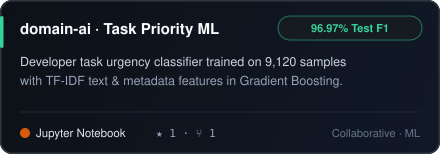
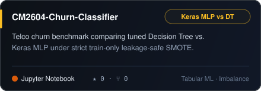
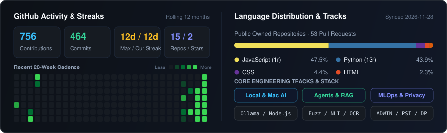

  

  <strong>Building dependable machine-learning systems, from evidence-grounded LLM tools to data and model evaluation.</strong>

  
  
  

---

## About

I’m an **Artificial Intelligence and Data Science undergraduate at IIT Sri Lanka**, affiliated with **Robert Gordon University**. I previously worked as an **AI Engineering Intern at DecodeLabs**, building applied AI and computer-vision projects.

I’m interested in turning ML ideas into systems that are testable and useful: grounding language-model outputs in evidence, evaluating tool-using agents, monitoring data and model behavior, and building robust ML workflows.

## Featured work

  
  

  
  

  
  

**A result I’m proud of:** In my [CM3604 fact-checking project](https://github.com/Thush099/CM3604_CW), the fine-tuned DeBERTa NLI approach reached **88.24% accuracy (195/221)**, compared with a **50.68% majority baseline (112/221)** in the reported evaluation.

## Project portfolio

### LLM, agent, and evidence systems

- [**veridoc-forensics**](https://github.com/Thush099/veridoc-forensics) — Document OCR and restoration, tamper analysis, and evidence-based claim verification.
- [**traceguard-eval**](https://github.com/Thush099/traceguard-eval) — A deterministic sandbox for evaluating tool-using agents under schema errors and adversarial faults.
- [**rag-pipeline**](https://github.com/Thush099/rag-pipeline) — Hybrid retrieval, reranking, and sentence-level citation grounding, with a groundedness score that can gate a CI job.
- [**llm-eval-harness**](https://github.com/Thush099/llm-eval-harness) — Claim-level faithfulness checks, rubric-based evaluation, and model comparisons.
- [**SkillEvaluator**](https://github.com/Thush099/SkillEvaluator) — A fork of NVIDIA’s framework for evaluating agent skills.
- [**hiring-agent**](https://github.com/Thush099/hiring-agent) — A hiring-assistant project centered on rubric-based evaluation and calibration.

### Data quality and ML reliability

- [**data-profiler**](https://github.com/Thush099/data-profiler) — Dataset profiling, data contracts, anomaly checks, and remediation planning, with `--fail-on` exit codes for pipeline gating.
- [**drift-tracker**](https://github.com/Thush099/drift-tracker) — Batch monitoring for feature drift, prediction drift, and data quality, with severity-based exit codes.
- [**drift-detector**](https://github.com/Thush099/drift-detector) — Streaming drift detection with adaptive model retraining.
- [**fed-sim**](https://github.com/Thush099/fed-sim) — A federated-learning simulator for non-IID clients and differential-privacy experiments.

### Causal and multimodal learning

- [**uplift-ml**](https://github.com/Thush099/uplift-ml) — Uplift and conditional treatment-effect models with causal evaluation metrics.
- [**fusion-transformer**](https://github.com/Thush099/fusion-transformer) — A PyTorch model for combining tabular features and text with cross-attention.

### Open-source libraries

- [**cleanlab**](https://github.com/Thush099/cleanlab) — A fork of Cleanlab, focused on data-centric AI and token-classification workflows.
- [**chonkie**](https://github.com/Thush099/chonkie) — A fork of Chonkie, focused on text chunking and overlap behavior.

## Open-source focus

I’m especially interested in reliability edge cases: **recursive chunk boundaries** in Chonkie, **token-classification ranking** in Cleanlab, **rubric auditability** in hiring-agent, and **evaluation-runner usability** in SkillEvaluator. See the linked repositories for the projects and their current state.

Every portfolio repository above carries a `quality/release-ready-2026-11` pull request from a recent release-readiness pass: validation at public API and CLI boundaries, regression tests for numerical corner cases (non-finite values, duplicate IDs, empty groups), deterministic benchmark fixtures, read-only GitHub Actions test workflows with Dependabot, and exit-code gating so data-quality and retrieval tools can fail a pipeline when their thresholds are crossed.

## Tools I use

  
  
  
  
  
  
  
  
  
  

## GitHub activity

  

  Profile visuals are generated from GitHub data by <a href="./scripts/generate_profile_cards.py"><code>scripts/generate_profile_cards.py</code></a>.

