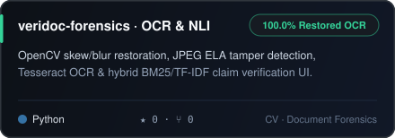
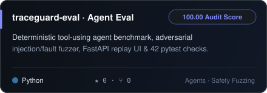
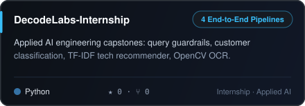

  

  
  
  

---

### About Me

- **Education:** BSc (Hons) **Artificial Intelligence & Data Science** undergraduate at **IIT Sri Lanka** (affiliated with **Robert Gordon University**)
- **Industry Experience:** Former **AI Engineering Intern at DecodeLabs** — delivered end-to-end applied ML, NLP recommender, guardrail, and OpenCV/OCR pipelines
- **Engineering Focus:** Multimodal OCR forensics & claim auditing, adversarial tool-agent evaluation, hybrid retrieval (RAG, FActScore NLI, G-Eval), streaming ML observability, and open-source ML tooling

---

### Live GitHub Activity & Language Distribution

  

---

### Featured Systems & Benchmarks

  
  

  
  

  
  

<b>View Detailed Methodology & Verified Metrics</b>

 

| Repository | Scope & Engineering Details | Verified Results & Highlights |
| :--- | :--- | :--- |
| [**`veridoc-forensics`**](https://github.com/Thush099/veridoc-forensics) | Multimodal document auditor combining OpenCV skew/blur restoration, JPEG Q90 ELA + MAD noise tamper heatmaps, Tesseract OCR, hybrid BM25/TF-IDF claim verification, and FastAPI Studio UI | Restores degraded OCR char accuracy from `0.0%` → `99.7%` (`66.7%` → `99.9%` mean across suite), `100.0%` claim verdict & tamper accuracy, `16` passing `pytest` tests |
| [**`traceguard-eval`**](https://github.com/Thush099/traceguard-eval) | Deterministic multi-step tool-agent sandbox, adversarial prompt-injection & HTTP/JSON fault fuzzer, schema/budget guards, and FastAPI Trace Replay UI | `TraceGuardHardenedAgent` scores **`100.00`** vs `63.33` (`SchemaRetryAgent`) & `39.58` (`NaiveAgent`) on benchmark (`100.00` vs `61.00` vs `37.69` on 30-run fuzz); `17` passing `pytest` tests |
| [**`CM3604_CW`**](https://github.com/Thush099/CM3604_CW) | Automated fact-checking of LLM outputs against BM25 evidence passages with grouped CV ablations & error analysis | Majority baseline `50.68%` (`112/221`) → Lexical overlap `84.16%` (`186/221`) → Fine-tuned DeBERTa NLI `88.24%` (`195/221`) |
| [**`DecodeLabs-Internship`**](https://github.com/Thush099/DecodeLabs-Internship) | Four applied AI capstones spanning input guardrails, customer classification, TF-IDF skill-gap recommendations, and document OCR | Combines OpenCV perspective/contrast normalization with Tesseract extraction across end-to-end runnable modules |
| [**`seniruvitharanage/domain-ai`**](https://github.com/seniruvitharanage/domain-ai) | Contributed priority-scoring ML sub-pipeline merging TF-IDF developer issue text with repository & workflow metadata | Gradient Boosting model trained on `9,120` samples achieving `96.97%` accuracy & weighted F1 on `2,280` test cases |
| [**`CM2604-Churn-Classifier`**](https://github.com/Thush099/CM2604-Churn-Classifier) | Telco customer churn prediction comparing hyperparameter-tuned Decision Tree and Dropout/EarlyStopping Keras MLP | Strict train-only SMOTE oversampling to prevent data leakage under ROC-AUC and generalization-gap evaluation |

---

### Open-Source Contributions & Enhanced Forks

| Repository | Upstream Project | Engineering Contributions & Verification |
| :--- | :--- | :--- |
| [**`Thush099/chonkie`**](https://github.com/Thush099/chonkie) | [`feyninc/chonkie`](https://github.com/feyninc/chonkie) | Fixed `OverlapRefinery._split_text` & `_recursive_overlap` infinite-loop / whitespace chunk boundary bugs ([`fix/overlap-refinery-recursive-whitespace`](https://github.com/Thush099/chonkie/tree/fix/overlap-refinery-recursive-whitespace), upstream [`#681`](https://github.com/feyninc/chonkie/issues/681)); `89` refinery & recursive chunker tests pass (`4` `from_recipe` tests deselected without `huggingface_hub`) |
| [**`Thush099/cleanlab`**](https://github.com/Thush099/cleanlab) | [`cleanlab/cleanlab`](https://github.com/cleanlab/cleanlab) | Fixed `IndexError` bounds ordering in `token_classification.rank.issues_from_scores` (upstream [`#1338`](https://github.com/cleanlab/cleanlab/issues/1338)) and single-class `K == 1` `ValueError` in `rank.get_normalized_margin_for_each_label` (upstream [`#1356`](https://github.com/cleanlab/cleanlab/issues/1356)) on [`fix/rank-boundary-guards`](https://github.com/Thush099/cleanlab/tree/fix/rank-boundary-guards); `124` upstream/regression tests pass across rank, token classification, util & validation modules |
| [**`Thush099/hiring-agent`**](https://github.com/Thush099/hiring-agent) | [`interviewstreet/hiring-agent`](https://github.com/interviewstreet/hiring-agent) | Resolved scoring clamping, JSON extraction & defensive transform bugs and built [`calibration_audit.py`](https://github.com/Thush099/hiring-agent/blob/feat/offline-rubric-calibration-audit/calibration_audit.py) for offline rubric integrity (`100.0%` tier accuracy, `97.2%` evidence grounding) and counterfactual fairness auditing (`0.00` delta, `1.000` Kendall's τ) on [`feat/offline-rubric-calibration-audit`](https://github.com/Thush099/hiring-agent/tree/feat/offline-rubric-calibration-audit); `13` passing tests |

---

### ML & LLM Engineering Toolkit

A suite of standalone, modular Python packages covering retrieval, LLM faithfulness, production drift monitoring, differential privacy, causal inference, and multimodal attention — each shipped with runnable CLIs and automated `pytest` suites.

<table>
  <tr>
    <td width="50%" valign="top">
      <strong>LLM Systems &amp; Evaluation</strong>
      <ul>
        <li>
          <a href="https://github.com/Thush099/rag-pipeline"><code>rag-pipeline</code></a> 
          Okapi BM25 + L2-normalized dense cosine retrieval, Reciprocal Rank Fusion (<code>k=60</code>), cross-encoder proximity re-ranking, and sentence-level <code>[doc_id]</code> citation grounding.
        </li>
        <li>
          <a href="https://github.com/Thush099/llm-eval-harness"><code>llm-eval-harness</code></a> 
          Atomic claim decomposition with numeric/negation contradiction detection, rubric G-Eval scoring, and JSON/Markdown multi-model leaderboards.
        </li>
      </ul>
    </td>
    <td width="50%" valign="top">
      <strong>ML Observability &amp; Drift Monitoring</strong>
      <ul>
        <li>
          <a href="https://github.com/Thush099/drift-detector"><code>drift-detector</code></a> 
          Streaming concept-drift detection via Hoeffding-bound <code>ADWIN</code> and two-sided <code>Page-Hinkley</code> tests paired with adaptive <code>SGDRegressor</code> retraining.
        </li>
        <li>
          <a href="https://github.com/Thush099/drift-tracker"><code>drift-tracker</code></a> 
          Batch feature, prediction, and data-quality observability across <code>PSI</code>, two-sample <code>KS</code>, <code>Jensen-Shannon</code> divergence, unseen category detection, and schema contracts.
        </li>
      </ul>
    </td>
  </tr>
  <tr>
    <td width="50%" valign="top">
      <strong>Data Contracts &amp; Federated Privacy</strong>
      <ul>
        <li>
          <a href="https://github.com/Thush099/data-profiler"><code>data-profiler</code></a> 
          Semantic column inference (5 types), IQR/z-score outlier &amp; leakage audits, declarative schema validation, and prioritized dataset remediation plans.
        </li>
        <li>
          <a href="https://github.com/Thush099/fed-sim"><code>fed-sim</code></a> 
          PyTorch <code>DP-FedAvg</code> simulator with Dirichlet non-IID client partitions, per-client L2 update clipping, calibrated Laplace/Gaussian DP noise, and drift logging.
        </li>
      </ul>
    </td>
    <td width="50%" valign="top">
      <strong>Causal &amp; Multimodal Learning</strong>
      <ul>
        <li>
          <a href="https://github.com/Thush099/uplift-ml"><code>uplift-ml</code></a> 
          <code>S-Learner</code>, <code>T-Learner</code>, and 3-stage <code>X-Learner</code> causal CATE estimators benchmarked with Qini coefficient, AUUC, PEHE, and decile lift calibration.
        </li>
        <li>
          <a href="https://github.com/Thush099/fusion-transformer"><code>fusion-transformer</code></a> 
          PyTorch multimodal classifier fusing <code>FT-Transformer</code> per-column feature tokenizers with transformer text encoders via bidirectional <code>nn.MultiheadAttention</code>.
        </li>
      </ul>
    </td>
  </tr>
</table>

---

### Core Stack & Tooling

  
  
  
  
  
  
  
  
  
  
  
  
  

  Self-hosted SVG telemetry and project showcase cards generated directly from GitHub GraphQL via <a href="./scripts/generate_profile_cards.py"><code>scripts/generate_profile_cards.py</code></a>.

