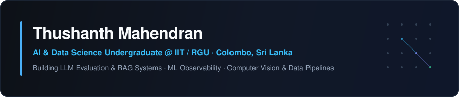

  

  
  
  
  

---

### About Me

I'm an **Artificial Intelligence & Data Science undergraduate** at the **Informatics Institute of Technology (IIT / Robert Gordon University)** in Colombo, focused on turning messy real-world data and ML research ideas into tested, reproducible software.

- **Core Focus:** LLM evaluation & automated fact-checking, hybrid RAG pipelines, real-time ML drift observability, and computer vision OCR pipelines.
- **Approach:** Clean modular Python, deterministic baselines before complexity, and quantitative evaluation across precision/recall, faithfulness, and calibration.
- **Currently Exploring:** Multimodal tabular-text fusion, causal uplift modeling, and privacy-preserving federated learning.

---

### Featured Projects

| Project | Domain | Highlights & Stack |
|---|---|---|
| **[CM3604_CW — Automated LLM Fact-Checking](https://github.com/Thush099/CM3604_CW)** | NLP / Deep Learning | FActScore claim verification comparing lexical overlap (**84.16%**) and DeBERTa textual entailment (**88.24%**) across 221 labeled claims, with ablation studies & error analysis (`PyTorch`, `Transformers`, `NLTK`, `spaCy`) |
| **[DecodeLabs-Internship — AI Engineering Capstones](https://github.com/Thush099/DecodeLabs-Internship)** | Computer Vision & RecSys | 4-project internship portfolio featuring an OOP Tesseract OCR pipeline (adaptive thresholding, deskewing, ≥80% confidence gate) and a regex-tokenized TF-IDF tech-stack recommender (`OpenCV`, `Tesseract`, `scikit-learn`, `Pandas`) |
| **[Domain-Specific AI Assistant](https://github.com/seniruvitharanage/domain-ai)** *(Collab)* | RAG & Applied ML | Built RAG embedding/retrieval modules (`ChromaDB`, `Ollama`), frontend integration, and a Gradient Boosting academic task-priority model (**96.97%** test accuracy on 11.4k samples) |
| **[CM2604-Churn-Classifier](https://github.com/Thush099/CM2604-Churn-Classifier)** | Tabular ML | Telco customer churn benchmark comparing tuned Decision Trees and Keras MLPs with leakage-safe SMOTE oversampling and ROC-AUC / generalization-gap analysis |

---

### ML & LLM Engineering Toolkit

Tested, standalone Python tools and reference implementations covering retrieval, evaluation, observability, and applied ML:

<table>
  <tr>
    <td width="50%" valign="top">
      <strong>LLM &amp; Retrieval Systems</strong>
      <ul>
        <li><a href="https://github.com/Thush099/rag-pipeline"><b>rag-pipeline</b></a> — Hybrid Okapi BM25 + dense vector retrieval with Reciprocal Rank Fusion &amp; citation grounding</li>
        <li><a href="https://github.com/Thush099/llm-eval-harness"><b>llm-eval-harness</b></a> — Rubric-based G-Eval &amp; claim-level faithfulness scoring with leaderboard reports</li>
      </ul>
      <strong>Applied ML &amp; Research</strong>
      <ul>
        <li><a href="https://github.com/Thush099/fusion-transformer"><b>fusion-transformer</b></a> — PyTorch multimodal tabular + text model with cross-attention</li>
        <li><a href="https://github.com/Thush099/uplift-ml"><b>uplift-ml</b></a> — Causal S/T/X-Learner meta-learners with Qini &amp; AUUC evaluation</li>
        <li><a href="https://github.com/Thush099/fed-sim"><b>fed-sim</b></a> — FedAvg simulator with non-IID splits &amp; calibrated differential privacy</li>
      </ul>
    </td>
    <td width="50%" valign="top">
      <strong>ML Observability &amp; Data Quality</strong>
      <ul>
        <li><a href="https://github.com/Thush099/drift-detector"><b>drift-detector</b></a> — Streaming concept drift detection using ADWIN &amp; Page-Hinkley tests with adaptive retraining</li>
        <li><a href="https://github.com/Thush099/drift-tracker"><b>drift-tracker</b></a> — Batch PSI, Kolmogorov–Smirnov &amp; Jensen–Shannon feature/prediction drift monitoring</li>
        <li><a href="https://github.com/Thush099/data-profiler"><b>data-profiler</b></a> — Declarative schema contracts, outlier/missingness profiling &amp; remediation plans</li>
      </ul>
    </td>
  </tr>
</table>

---

### Tech Stack

**Languages**  

**ML, DL & Computer Vision**  

**Data & Tooling**  

