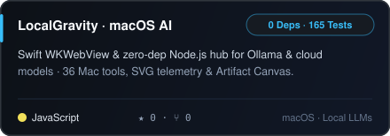
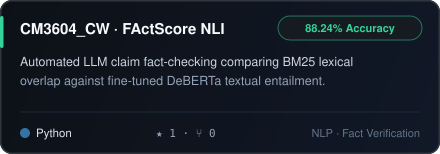

  

  <strong>Building native macOS AI tooling, deterministic agent evaluation harnesses, OCR forensics, and reliable ML systems.</strong>

  
  
  
  

  <b>14</b> real-pipeline web UIs &nbsp;·&nbsp; <b>1,350+</b> automated tests &nbsp;·&nbsp; <b>11</b> CI-gated pipelines &nbsp;·&nbsp; <b>0</b> front-end build steps 
  Every repo carries a review-ready quality PR with the full suite green — nothing merges to <code>main</code> without review.

---

### About Me

- **Education:** BSc (Hons) **Artificial Intelligence & Data Science** undergraduate at **IIT Sri Lanka** (affiliated with **Robert Gordon University**)
- **Currently:** **Artificial Intelligence Intern at SLT-MOBITEL** — Digital Platforms Development Section, designing and implementing intelligent features for enterprise-scale platforms
- **Previously:** **AI Engineering Intern at DecodeLabs** (applied ML classifiers, NLP skill recommenders, query guardrails, OpenCV/OCR pipelines) · **Enterprise Operations at Gennext (Pvt) Ltd** (IT infrastructure & system reliability)
- **Engineering Focus:** Local-first native macOS AI apps (Swift + Node.js), tool-using agent evaluation, evidence-grounded NLI & RAG verification, and open-source ML library reliability

---

### Live GitHub Activity & Language Distribution

  

---

### Currently Building — Native macOS & Desktop AI

<table>
  <tr>
    <td width="50%" valign="top">
      <a href="https://github.com/Thush099/LocalGravity"><strong>LocalGravity</strong></a> · Native macOS AI Command Center 
      Compiled Swift <code>WKWebView</code> shell paired with a zero-dependency Node.js agent runtime for local Ollama and cloud models. Ships with a live Apple Silicon SVG telemetry dashboard, isolated split-pane Artifact Canvas, 47 Mac &amp; web tools, 30 starter skills, voice/TTS, scheduled <code>launchd</code> jobs, and <strong>284 passing tests</strong>.
    </td>
    <td width="50%" valign="top">
      <a href="https://github.com/Thush099/omni-code/tree/feature/ux-desktop-improvements"><strong>omni-code</strong></a> · Multi-LLM Desktop &amp; CLI Assistant 
      Active engineering fork of <a href="https://github.com/GraysonBannister/omni-code"><code>GraysonBannister/omni-code</code></a> adding an OS-global <code>Alt+Space</code> quick-ask launcher, command palette, Gemini thought-signature persistence on tool-use blocks, themed confirmation overlays, and secret-safe CI validation in <a href="https://github.com/Thush099/omni-code/pull/1">PR #1</a>.
    </td>
  </tr>
  <tr>
    <td width="50%">
      
    </td>
    <td width="50%">
      
    </td>
  </tr>
  <tr>
    <td colspan="2" valign="top">
      <a href="https://github.com/Thush099/lattice"><strong>lattice</strong></a> · Native macOS Study Companion 
      Native macOS study companion for YouTube &amp; SoundCloud — timestamped notes tied to playback, spaced repetition, a unified library, offline downloads, and focused study tracking.
    </td>
  </tr>
</table>

---

### Featured Systems & Benchmarks

  
  

  
  

  
  

<b>View Full Methodology &amp; Verified Benchmark Results</b>

 

| Repository | Architecture & Scope | Verified Results & Test Runs |
| :--- | :--- | :--- |
| [**`LocalGravity`**](https://github.com/Thush099/LocalGravity) | Compiled Swift `WKWebView` + dependency-free Node.js (`>=22`) runtime for Ollama & cloud APIs, Artifact Canvas sandbox, Apple Silicon SVG telemetry & 47 Mac tools | `0` npm runtime dependencies; **`284`** passing tests (`node --test`); GitHub Actions CI |
| [**`veridoc-forensics`**](https://github.com/Thush099/veridoc-forensics) | OpenCV skew/blur restoration, JPEG Q90 ELA + smooth-noise MAD Z-score tamper detection, Tesseract OCR, hybrid BM25/TF-IDF claim verification, FastAPI UI | Mean char &amp; word OCR accuracy **`66.7%` → `100.0%`** (`0.0%` → `100.0%` on degraded scan), `100.0%` claim verdict &amp; tamper accuracy; **`48`** passing `pytest` tests |
| [**`traceguard-eval`**](https://github.com/Thush099/traceguard-eval) | Deterministic tool-agent sandbox, adversarial prompt-injection &amp; HTTP/JSON fault fuzzer, schema/step-budget contracts, FastAPI Trace Replay UI | `TraceGuardHardenedAgent` **`100.00`** vs `63.33` (`SchemaRetryAgent`) &amp; `39.58` (`NaiveAgent`) benchmark (`100.00` vs `61.00` vs `37.69` on 30-run fuzz); **`42`** passing `pytest` tests |
| [**`CM3604_CW`**](https://github.com/Thush099/CM3604_CW) | Automated fact-checking of LLM outputs against BM25 evidence passages with grouped CV ablations &amp; error analysis | Majority baseline `50.68%` (`112/221`) → Lexical overlap `84.16%` (`186/221`) → Fine-tuned DeBERTa NLI **`88.24%` (`195/221`)** |
| [**`DecodeLabs-Internship`**](https://github.com/Thush099/DecodeLabs-Internship) | Four applied AI capstones covering input guardrails, customer classification, TF-IDF skill-gap recommendations, and document OCR | Combines OpenCV perspective/contrast normalization with Tesseract extraction across standalone runnable pipelines |
| [**`seniruvitharanage/domain-ai`**](https://github.com/seniruvitharanage/domain-ai) | Priority-scoring ML pipeline merging TF-IDF developer issue text with repository &amp; workflow metadata | Gradient Boosting model trained on `9,120` samples achieving **`96.93%`** accuracy &amp; weighted F1 across `2,280` test cases |
| [**`CM2604-Churn-Classifier`**](https://github.com/Thush099/CM2604-Churn-Classifier) | Telco customer churn benchmark comparing hyperparameter-tuned Decision Tree and Keras MLP | Strict train-only SMOTE oversampling to prevent leakage under ROC-AUC and generalization-gap evaluation |

---

### Open-Source Forks & Upstream Contributions

| Repository | Upstream Project | Engineering Work & Verification |
| :--- | :--- | :--- |
| [**`Thush099/omni-code`**](https://github.com/Thush099/omni-code) | [`GraysonBannister/omni-code`](https://github.com/GraysonBannister/omni-code) | Added OS-global `Alt+Space` quick-ask launcher, command palette, Gemini thought-signature persistence, themed dialogs, and secret-safe CI gating ([PR #1](https://github.com/Thush099/omni-code/pull/1), `build-test` passing) |
| [**`Thush099/ragas`**](https://github.com/Thush099/ragas) | [`vibrantlabsai/ragas`](https://github.com/vibrantlabsai/ragas) | Built offline result-distribution reporting and CI-ready run comparison with p10 tail protection — `35` passing tests, upstream `ruff` lint/format clean ([`33f378c`](https://github.com/Thush099/ragas/commit/33f378c), [`6c825cf`](https://github.com/Thush099/ragas/commit/6c825cf)) |
| [**`Thush099/SkillEvaluator`**](https://github.com/Thush099/SkillEvaluator) | [`NVIDIA/SkillEvaluator`](https://github.com/NVIDIA/SkillEvaluator) | Built standalone interactive evaluation runner &amp; architecture guide ([`feature/interactive-eval-and-workflow`](https://github.com/Thush099/SkillEvaluator/tree/feature/interactive-eval-and-workflow)), Markdown table escaping &amp; missing-path quickstart diagnostics (`4` passing `test_quickstart_eval.py` checks) |
| [**`Thush099/chonkie`**](https://github.com/Thush099/chonkie) | [`feyninc/chonkie`](https://github.com/feyninc/chonkie) | Fixed `OverlapRefinery._split_text` and `_recursive_overlap` infinite-loop, exact-fit overlap &amp; whitespace boundary bugs (upstream `#681`, [`fix/overlap-refinery-recursive-whitespace`](https://github.com/Thush099/chonkie/tree/fix/overlap-refinery-recursive-whitespace)); `108` refinery &amp; recursive chunker tests pass (`4` `from_recipe` tests deselected without `huggingface_hub`) |
| [**`Thush099/cleanlab`**](https://github.com/Thush099/cleanlab) | [`cleanlab/cleanlab`](https://github.com/cleanlab/cleanlab) | Fixed `IndexError` bounds ordering in `token_classification.rank.issues_from_scores` (`#1338`), single-class `K == 1` `ValueError` in `rank.get_normalized_margin_for_each_label` (`#1356`), and non-finite score alignment on [`fix/rank-boundary-guards`](https://github.com/Thush099/cleanlab/tree/fix/rank-boundary-guards) (`134` tests passing across rank, token classification, util &amp; validation suites) |
| [**`Thush099/hiring-agent`**](https://github.com/Thush099/hiring-agent) | [`interviewstreet/hiring-agent`](https://github.com/interviewstreet/hiring-agent) | Hardened scoring bounds, non-finite value rejection &amp; JSON extraction; built [`calibration_audit.py`](https://github.com/Thush099/hiring-agent/blob/main/calibration_audit.py) for offline rubric integrity &amp; counterfactual fairness perturbation testing ([`feat/offline-rubric-calibration-audit`](https://github.com/Thush099/hiring-agent/tree/feat/offline-rubric-calibration-audit); `36` passing `pytest` tests) |

---

### ML, Data Quality & Retrieval Toolkit

Modular Python libraries spanning hybrid RAG, LLM faithfulness evaluation, streaming/batch drift observability, privacy-preserving federated training, causal uplift, and multimodal cross-attention — each shipped with CI workflows, boundary validation, CLIs, and automated `pytest` suites, published as review-ready quality PRs.

<table>
  <tr>
    <td width="50%" valign="top">
      <strong>LLM Systems &amp; Evaluation</strong>
      <ul>
        <li>
          <a href="https://github.com/Thush099/rag-pipeline"><code>rag-pipeline</code></a> 
          Okapi BM25 + L2-normalized dense cosine retrieval, Reciprocal Rank Fusion (<code>k=60</code>), cross-encoder proximity re-ranking, sentence-level <code>[doc_id]</code> citation grounding with CI threshold gating, and a web workbench whose mode-compare rank matrix exposes the RRF fusion directly.
        </li>
        <li>
          <a href="https://github.com/Thush099/llm-eval-harness"><code>llm-eval-harness</code></a> 
          Atomic claim decomposition with numeric/negation contradiction detection, finite-weight rubric G-Eval scoring, and JSON/Markdown leaderboards.
        </li>
      </ul>
    </td>
    <td width="50%" valign="top">
      <strong>ML Observability &amp; Drift Monitoring</strong>
      <ul>
        <li>
          <a href="https://github.com/Thush099/drift-detector"><code>drift-detector</code></a> 
          Streaming concept-drift detection via Hoeffding-bound <code>ADWIN</code> and two-sided <code>Page-Hinkley</code> tests paired with adaptive <code>SGDRegressor</code> retraining.
        </li>
        <li>
          <a href="https://github.com/Thush099/drift-tracker"><code>drift-tracker</code></a> 
          Batch feature, prediction, and data-quality observability across <code>PSI</code>, two-sample <code>KS</code>, and <code>Jensen-Shannon</code> divergence with severity exit codes.
        </li>
      </ul>
    </td>
  </tr>
  <tr>
    <td width="50%" valign="top">
      <strong>Data Contracts &amp; Federated Privacy</strong>
      <ul>
        <li>
          <a href="https://github.com/Thush099/data-profiler"><code>data-profiler</code></a> 
          Semantic column inference, IQR/z-score outlier &amp; leakage audits, declarative schema validation, remediation plans, and <code>--fail-on</code> CI gates.
        </li>
        <li>
          <a href="https://github.com/Thush099/fed-sim"><code>fed-sim</code></a> 
          PyTorch <code>DP-FedAvg</code> simulator with Dirichlet non-IID client partitions, per-client L2 update clipping, calibrated Laplace/Gaussian DP noise, and drift tracking.
        </li>
      </ul>
    </td>
    <td width="50%" valign="top">
      <strong>Causal &amp; Multimodal Learning</strong>
      <ul>
        <li>
          <a href="https://github.com/Thush099/uplift-ml"><code>uplift-ml</code></a> 
          <code>S-Learner</code>, <code>T-Learner</code>, and 3-stage <code>X-Learner</code> causal CATE estimators benchmarked with Qini coefficient, AUUC, PEHE, and decile lift calibration.
        </li>
        <li>
          <a href="https://github.com/Thush099/fusion-transformer"><code>fusion-transformer</code></a> 
          PyTorch multimodal classifier fusing <code>FT-Transformer</code> per-column feature tokenizers with transformer text encoders via bidirectional <code>nn.MultiheadAttention</code>.
        </li>
      </ul>
    </td>
  </tr>
</table>

---

### Engineering Standards — Release-Ready by Default

These aren't one-off demos. Every repository — native macOS apps, Python ML libraries, and evaluation harnesses alike — is brought to the same bar before it ships:

| Standard | What it means in practice |
| :--- | :--- |
| **Real-pipeline web UIs** | 14 local studios drive each repo's *actual* pipeline in the browser — no mock data, no canned responses. Single-file HTML behind a standard-library server, zero front-end build. |
| **Boundary validation** | Every public CLI, API, and model boundary rejects invalid input with a clear `HTTP 400` or `ValueError` — never a silent wrong number. Regression-tested at each edge. |
| **CI pipeline gating** | Opt-in `--fail-on` / `--min-*` threshold exit codes in 10 repos make CI fail the instant a quality metric regresses. |
| **Numerical correctness** | Corner-case regression tests — NaN/inf rejection, score clamping, boundary ordering — guarantee metrics never mislead. |
| **Accessible by default** | Skip links, semantic landmarks, `role="alert"` error regions, and `prefers-reduced-motion` guards in every UI. |
| **Deterministic CI & tests** | 850+ automated `pytest` tests with GitHub Actions workflows across the release-ready Python projects. |

---

### Interactive Web UIs

Every tool above ships a local web UI that drives its **real pipeline** in the browser — no demo data, no mock responses. Each is a single self-contained HTML page behind a small standard-library server (`python ui/server.py`), so it runs anywhere with no front-end build step. These aren't screenshots — clone any repo and run the studio against the real code.

| Repository | Studio | What it visualizes |
| :--- | :--- | :--- |
| [`rag-pipeline`](https://github.com/Thush099/rag-pipeline) | Retrieval workbench | Citations and sentence-level grounding for a live query |
| [`data-profiler`](https://github.com/Thush099/data-profiler) | Data-quality spec sheet | Contract violations, profile, and remediation plan |
| [`drift-tracker`](https://github.com/Thush099/drift-tracker) | Drift observability | Feature/prediction drift with OK/WARN/ALERT severity |
| [`drift-detector`](https://github.com/Thush099/drift-detector) | Concept-drift seismograph | Streaming ADWIN / Page-Hinkley detections over time |
| [`uplift-ml`](https://github.com/Thush099/uplift-ml) | Causal uplift lab | Qini/AUUC curves and per-decile uplift by treatment arm |
| [`llm-eval-harness`](https://github.com/Thush099/llm-eval-harness) | Eval leaderboard | Faithfulness and rubric scores side by side per model |
| [`fed-sim`](https://github.com/Thush099/fed-sim) | DP-FedAvg console | Round-by-round accuracy against the privacy–utility tradeoff |
| [`fusion-transformer`](https://github.com/Thush099/fusion-transformer) | Training console | Loss curves and macro-F1 as the fusion model trains |
| [`veridoc-forensics`](https://github.com/Thush099/veridoc-forensics) | Verification studio | OCR restoration, tamper flags, and claim-level evidence |
| [`traceguard-eval`](https://github.com/Thush099/traceguard-eval) | Agent reliability studio | Trace replay and fault-fuzzing under adversarial errors |
| [`hiring-agent`](https://github.com/Thush099/hiring-agent) | Rubric scoring workbench | Category clamping and final-score audit, with human review |
| [`SkillEvaluator`](https://github.com/Thush099/SkillEvaluator) | Skill-eval scorecard | Trigger precision/recall across positive/negative/adversarial cases |
| [`cleanlab`](https://github.com/Thush099/cleanlab) | Label-quality inspector | Per-token label-quality scores and flagged issue candidates |
| [`chonkie`](https://github.com/Thush099/chonkie) | Chunk-context workbench | Chunk splitting and the overlap context that stitches chunks |

---

### Core Stack

  
  
  
  
  
  
  
  
  
  
  
  

  Self-hosted SVG telemetry and project showcase cards generated automatically from GitHub GraphQL via <a href="./scripts/generate_profile_cards.py"><code>scripts/generate_profile_cards.py</code></a> and <a href="./.github/workflows/update_profile.yml"><code>update_profile.yml</code></a>.

